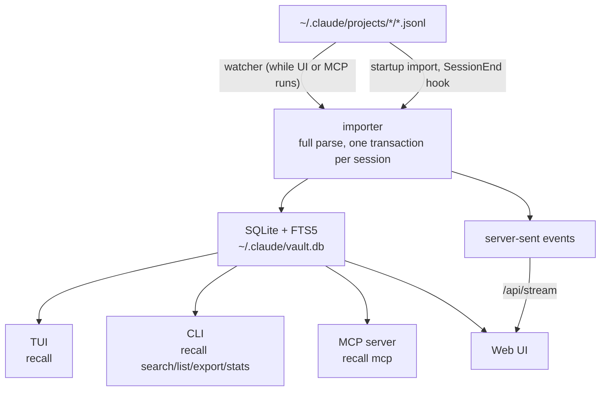

# Architecture

`recall` is one binary. The CLI starts each way into the archive: the TUI (`recall`), the MCP server (`recall mcp`, started by Claude Code) and the web UI (`recall ui`), and it also searches, lists and exports on its own.

The web UI and the MCP server import everything on startup and run the watcher while they are up, the MCP servers one at a time. The `SessionEnd` hook imports when a session ends. The TUI and the CLI read the archive as it is.



## Sync timing

| State | What happens |
|---|---|
| UI or MCP running | Changed transcripts are imported after they stop changing for 300 ms, from `~/.claude/projects` and every tree in `extra_projects_dirs` |
| A session ends | The plugin's `SessionEnd` hook runs `recall import` |
| UI or MCP starts | A full import catches up on everything written in the meantime, in the background |

A tree in `extra_projects_dirs` that is not there yet, such as a container's before its first run, is looked for again on every poll and imported from once it appears. Inside a container, the plugin's `SessionEnd` hook imports into the container's own `~/.claude/vault.db`, not the host's: the host's watcher and catch-up import are what archive a container's sessions. Do not bind-mount the host's `vault.db` into a container.

The watcher polls file sizes and mtimes every 250 ms; see [ADR-002](adr/002-fs-watch-for-realtime-updates.md). Every Claude Code session runs its own `recall mcp`, but only one per set of transcript trees watches and imports: the one holding the lock file next to the database named after those trees (`vault.db.watch-<hash>.lock`), so sessions run with another `CLAUDE_CONFIG_DIR` or `extra_projects_dirs` have one of their own. The others look every 5 seconds and take over when it exits, importing first what changed while nobody watched. The holder touches the lock file every second; one untouched for a minute, as when `claude` is suspended with Ctrl-Z and its `recall mcp` with it, is watched around by one of the others through `vault.db.watch-<hash>.lock.1`. A holder that finds a later lock file held and touched stops watching and waits with the others, so after the machine sleeps, when every holder looks stopped, one process watches again within a second or two of waking. The web UI watches regardless, and the `SessionEnd` hook and `recall import` still import alongside, so several importers can run at once: writers take the write lock at BEGIN and wait for it, and a session that fails to import does not stop the others. The WAL is cut back to 64 MB whenever it is reset, so a large import does not leave a WAL of its size behind.

## Database

```sql
sessions (session_id, project, project_path, git_branch, first_prompt,
          summary, message_count, started_at, ended_at, claude_version,
          file_mtime, file_size, imported_at, title)

messages (id, session_id, uuid, role, block_type, block_index, content,
          tool_name, tool_input, timestamp, turn_index)
          -- UNIQUE(session_id, uuid, block_index): a natural key, so a
          -- re-import of the whole file is idempotent

images (id, session_id, message_uuid, image_index, media_type, data)

messages_fts (content)  -- FTS5, porter unicode61 tokenizer
```

Each import mirrors the session's current JSONL: its rows are replaced in one transaction (see [ADR-003](adr/003-mirror-jsonl-not-independent-archive.md)). Sessions whose JSONL was deleted stay in the archive, which makes `vault.db` the only copy of them. Schema changes are additive migrations tracked by `PRAGMA user_version`.

### What is stored

| Stored (as `block_type`) | Excluded |
|--------|----------|
| `text` (user and assistant) | system events (turn_duration and others) |
| `thinking` | file-history-snapshot |
| `tool_use` and `tool_result` | sidechains (`isSidechain`) |
| `meta` (slash-command expansions, task notifications) | progress, queue-operation, last-prompt, pr-link |

## Web UI live updates

While the UI runs, it receives `session_updated` events over server-sent events. No Claude Code hook is needed.

The UI server's watcher sends one for every transcript it sees change, once the change is in the archive, whoever imported it: often the `recall mcp` of a Claude Code session or the `SessionEnd` hook gets to it first, and the watcher's own import finds it unchanged. What the server keeps between requests, such as the sessions each searched word is in, is dropped on these, and when another process commits to the archive (`PRAGMA data_version`).

- The list reads the session again (`/api/v2/sessions?id=`) and puts it in its place. A search's result set stays as it was found until the query changes.
- The open conversation reads what came after its last message (`/api/v2/sessions/:id/conversation?after=`), with that message's uuid and how many messages there are up to it. If they are not there as they were, as after a transcript is rewritten, the server says the range is stale and the page reads the conversation again. Events come in bursts while a session is written; the page reads after one at a time, and once more for those that came meanwhile. At the end of the conversation, the view follows the new messages; further up, a button counts them.
- A page in a background tab closes its stream, since a browser keeps at most six connections to one host, and reads the list and the open conversation again when it is shown.
